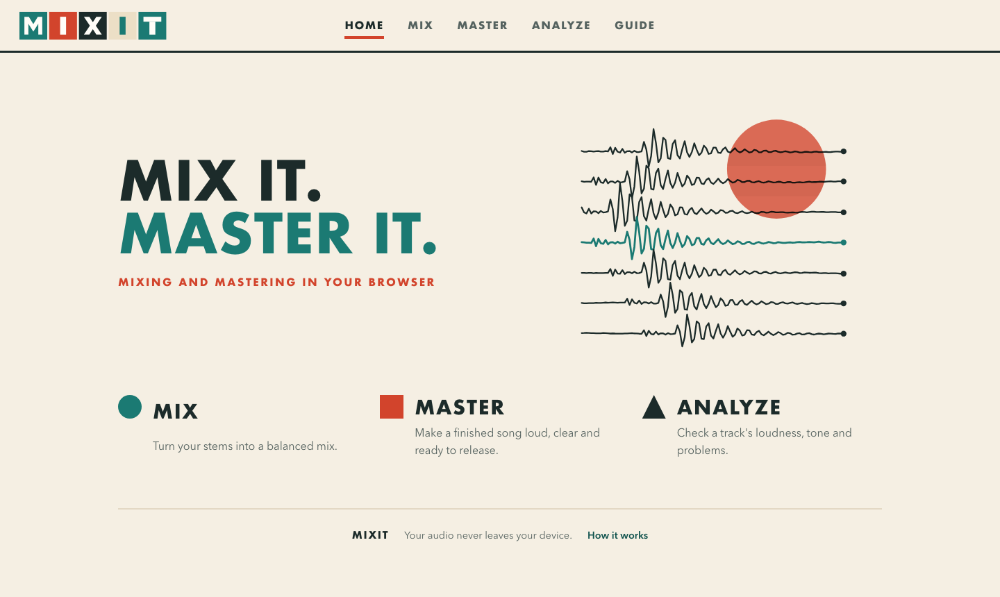
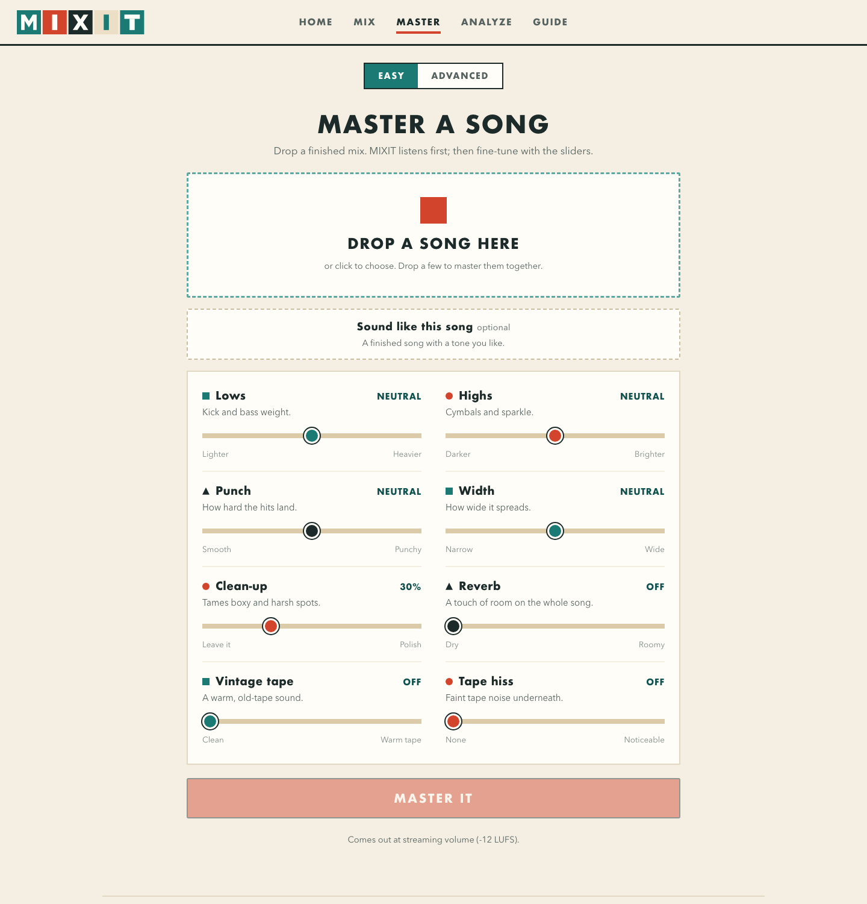

<h3 align="center">Mix it. Master it.</h3>

Mixing and mastering in your browser. Your audio never leaves your device.

<a href="https://mixit-opal.vercel.app"><b>Open MIXIT →</b></a>

MIXIT turns your stems into a balanced mix and your finished songs into release-ready
masters. Everything happens inside your browser tab: nothing is uploaded, there's no
account to make and nothing to install.

## How to use it

1. **[Open MIXIT](https://mixit-opal.vercel.app)** and choose **Mix**, **Master** or **Analyze**.
2. **Drop your files.** WAV, AIFF, FLAC, MP3 and M4A all work.
3. **Shape the sound** with eight simple sliders in **Easy**, or switch to **Advanced** for every setting.
4. **Compare** before and after at the same volume, then **Download all** as one ZIP or save each file on its own.
   The MP3 is 320 kbps, or a little lower for long songs so it stays under 10 MB for easy sharing.

## What it does

### Mix
- Sorts your stems into vocals, drums, bass, music and FX by their names.
- Balances them, keeps the vocal steady over the music, and adds reverb, echo and glue.
- Drop in your own rough bounce and MIXIT copies its balance.
- **Easy sliders:** vocal level, vocal clarity, lows, highs, punch, reverb, echo, vintage tape.
- **You get:** the mix as a WAV and an MP3, plus each part (vocals, drums, bass, music) as its own file.

### Master
- Listens to your song first and picks a starting point for it.
- Drop in a song you love and the tone leans toward it.
- **Easy sliders:** lows, highs, punch, width, clean-up, reverb, vintage tape, tape hiss.
- **You get:** a master WAV, an MP3 for sharing, a CD-quality WAV, a FLAC and a quality report.

### Videos, ads and podcasts
- Switch the Mix page to **Video, ad or podcast** and drop dialogue, music, effects and ambience.
- Voices are cleaned, evened out and matched; music, effects and ambience step back while someone speaks,
  already down by the first word.
- Clicks are taken out of dialogue, effects and ambience, and every edit gets a short fade (½, 1 or 2 frames).
- Pick where it's going (online video, podcast, TV in Europe or the US) and get a delivery check:
  loudness and peaks against the standard, dead air, and how even the voices are.
- **You get:** the mix as a WAV and an MP3, plus dialogue, music, effects and ambience as their own files.

### Analyze
Loudness, peaks, tone, stereo width and tempo, plus a check for hum, clicks, clipping
and background noise.

### In Advanced
Pitch correction, section-by-section mix moves, repair tools (clicks, hum, clipping,
noise), versions for each streaming platform, mono and vinyl versions, 5.1 and 7.1.4
surround with a headphone version, and every setting explained in plain words.

## Your audio stays yours

MIXIT is a web page that does all of its work on your computer. Your songs are read,
processed and saved right there in the browser. They are never sent anywhere, and
settings and presets are kept only in your browser.

## Good to know

- Works best in a current desktop browser: Chrome, Edge, Safari or Firefox.
- Keep the MIXIT tab in front while it works; browsers slow down tabs in the background.
- A four-minute song needs roughly 0.5–1 GB of memory while it renders.
- Easy mode always delivers at streaming volume (-12 LUFS) with a safe peak level.

## Credits

MP3 files are made with [LAME](https://lame.sourceforge.net) through
[lamejs](https://github.com/zhuker/lamejs), included unmodified under the LGPL
(see `js/vendor/LAME-LICENSE.txt`).
